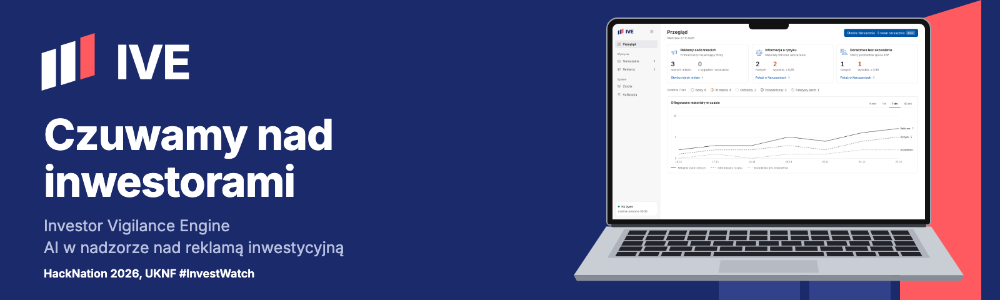

<p align="center">
  
</p>

# IVE: czuwamy nad inwestorami

Finfluencer poleca brokera. **Czy to reklama? Czy mówi o ryzyku? Czy może doradzać?**
IVE sam zbiera takie materiały, ocenia je trzema modułami i daje analitykowi sprawę z dowodem. Decyduje człowiek.

## Uruchom demo

Potrzebujesz tylko Dockera z Compose v2 i internetu. Bez kont i kluczy API.

```bash
git clone https://github.com/FerrisOfficial/hacknation.git
cd hacknation
cp .env.example .env
```

Potem wybierz jedną z dwóch opcji:

### Opcja A: szybkie demo (polecamy)

Reguły, bez modelu i GPU. Pierwszy build trwa kilka minut.

```bash
docker compose up --build web
```

### Opcja B: pełne demo z polskim LLM Bielik

Ok. 12 GB do pobrania, najlepiej z GPU. W `.env` ustaw `M2_ENGINE=hybrid` i `M3_ENGINE=hybrid`, potem:

```bash
docker compose up --build
```

### Potem, w obu opcjach

**1. Otwórz dashboard:** http://localhost:3000/hacknation

**2. Daj mu coś do znalezienia.** Baza startuje pusta.
Wejdź w **Źródła → Nowe źródło**, wybierz frazę YouTube (np. `kod polecający broker`) i zapisz. Materiały i wyniki pojawią się po pobraniu i analizie.

<details>
<summary>Albo dodaj gotowy zestaw źródeł dla M1 i M3</summary>

W `.env` ustaw `COLLECTOR_TOKEN=jury-demo`, uruchom stos ponownie, a potem w drugim terminalu:

```bash
curl -X POST -H "Authorization: Bearer jury-demo" http://localhost:3000/hacknation/api/sources/m1
curl -X POST -H "Authorization: Bearer jury-demo" http://localhost:3000/hacknation/api/sources/m3
```

Harmonogram pobiera jedno źródło na minutę, żeby YouTube nie blokował zapytań.
</details>

## Co sprawdzić w 2 minuty

1. **Źródła:** co, kiedy i z jakim skutkiem zostało pobrane.
2. **Reklamy:** kto reklamuje którą firmę inwestycyjną, z eksportem CSV.
3. **Naruszenia:** otwórz sprawę i zobacz cytat, regułę oraz przepis. `1` potwierdza, `2` to fałszywy alarm, `3` odkłada, decyzję można cofnąć.
4. **Widok podmiotu:** historia firmy i teczka ZIP z potwierdzonych spraw.
5. **Kalibracja:** przesuń próg i zobacz, co wypada. Precyzja i pełność liczą się z decyzji analityka.

## Gdy coś nie działa

| Objaw | Co zrobić |
|---|---|
| Pusty dashboard | dodaj źródło (krok 2) |
| „YouTube ogranicza zapytania” | odczekaj i kliknij „Ponów” w Źródłach |
| Zajęty port | zwolnij 3000, 3001, 5432, 8000 i 8100 |
| Start od zera | `docker compose down -v` (kasuje dane) |

## Stan na hackathon

- Kolektory: **YouTube i WWW**. TikTok, Instagram i Facebook są w planie.
- Pobieranie wideo w kontenerze wymaga poprawki ścieżki ffmpeg, więc reguły oparte na klatkach nie dają jeszcze wyników. Analiza opisów, napisów i stron tego nie potrzebuje.
- Progi i wagi wymagają kalibracji na danych UKNF.
- Ekrany w prezentacji i filmie pokazują interfejs na danych przykładowych.

## Zespół

**Maciej Stempniak, Mikołaj Karapka, Franciszek Przeliorz.** Trzy osoby, trzy agenty AI, jedno repo: [jak pracowaliśmy](docs/PROCES-AI.md).

## Jak to działa (dla ciekawych)

**M1** wykrywa reklamy finfluencerów, **M2** złą informację o ryzyku, **M3** doradztwo bez zezwolenia. Jeden materiał może dostać wynik z każdego.

- [Algorytmy M1 i M3, pipeline i architektura](docs/BACKEND.md)
- [M2: silniki, reguły i konfiguracja LLM](services/ml/README.md)
- [18 kryteriów informacji o ryzyku od UKNF](docs/materialy-uknf/kryteria-informacji-o-ryzyku.md)
- [Analiza klatek wideo](docs/KLATKI.md)
- [Kontrakt API](docs/KONTRAKT.md) i [wymagania zadania](docs/ZADANIE.md)

## Licencja

Kod projektu: MIT.

### Licencje zależności

Wszystkie zależności są open source. Kod projektu linkuje tylko biblioteki na licencjach permisywnych, a ffmpeg (GPL) działa jako osobny program.

| Komponent | Licencja |
|---|---|
| Next.js, React, Tailwind CSS, shadcn/ui, Base UI, TanStack Query, React Hook Form, @hookform/resolvers, Zod, Socket.io, pg-boss, sonner, next-themes, fflate, tw-animate-css, cn, openapi-fetch, openapi-typescript | MIT |
| class-variance-authority | Apache 2.0 |
| lucide-react | ISC |
| Inter (@fontsource-variable/inter) | SIL OFL 1.1 |
| Drizzle ORM | Apache 2.0 |
| postgres (postgres.js) | Unlicense |
| FastAPI, pydantic, selectolax, youtube-transcript-api, ONNX Runtime | MIT |
| httpx | BSD-3-Clause |
| Playwright, RapidOCR | Apache 2.0 |
| Chromium (headless shell, w obrazie `ml`) | BSD-3-Clause |
| yt-dlp | Unlicense |
| ffmpeg (pakiet Debiana w obrazie `media`, osobny proces, bez linkowania) | GPL 2+ |
| PostgreSQL | PostgreSQL License |
| Ollama | MIT |
| Obrazy bazowe: `node`, `python` (Debian), `postgres`, `ollama/ollama` | licencje projektów (MIT, PSF, PostgreSQL, MIT) + pakiety Debiana |
| Bielik-PL-11B v3.0 Instruct (SpeakLeash) | Apache 2.0 |
| Ruff, Pyright, Vitest, pytest | MIT |
| Biome | MIT lub Apache 2.0 |

