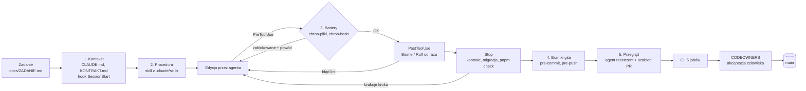

# Proces pracy z asystentami AI

Trzy osoby, każda z własnym agentem (Claude Code), równolegle w jednym repo przez 24 godziny.
Agent pisze większość kodu, więc jakość nie może zależeć od tego, czy pamięta zasady. Zasady są zapisane w repo i **egzekwowane automatycznie** na pięciu warstwach. Ta sama ścieżka obowiązuje każdą zmianę, ludzką i AI.



## 1. Kontekst: agent wie, co budujemy, zanim zacznie

| Plik | Co daje agentowi |
|---|---|
| [`CLAUDE.md`](../CLAUDE.md) | Stack, struktura, komendy, zasady (strict TS, pydantic, ścieżka danych, migracje, sekrety, git). |
| [`apps/web/CLAUDE.md`](../apps/web/CLAUDE.md) | Zasady lokalne Next.js 16 (basePath, shadcn, TanStack Query, Zod). Każdy katalog może mieć własny. |
| [`docs/ZADANIE.md`](ZADANIE.md) | Wymagania UKNF, kryteria jury, punktacja — agent czyta przed decyzją produktową. |
| [`docs/KONTRAKT.md`](KONTRAKT.md) | **Kontrakt API** UI ↔ backend ↔ AI. Źródło prawdy, dzięki któremu trzy osoby (i trzy agenty) pracują równolegle bez blokowania się. |
| Hook `SessionStart` | Na start sesji: gałąź, zmienione pliki, opóźnienie względem `main`, czas do oddania. |

**Contract-first.** Najpierw PR z kontraktem (#20), potem równolegle backend (#21), pipeline AI (#22) i UI (#32) — każdy agent implementował swoją stronę tego samego dokumentu. Typy klienta ML są generowane z OpenAPI FastAPI (`pnpm api:generate`), a CI odrzuca PR, w którym się rozjechały.

## 2. Procedury: skille zamiast pamięci agenta

Powtarzalne zadania mają opisaną ścieżkę krok po kroku w [`.claude/skills/`](../.claude/skills). Agent ładuje skill sam, gdy zadanie pasuje do opisu.

| Skill | Kiedy |
|---|---|
| [`zmiana-api-ml`](../.claude/skills/zmiana-api-ml/SKILL.md) | Nowy lub zmieniony endpoint FastAPI: kontrakt → pydantic → testy → `api:generate` → `@/lib/ml` → route handler. |
| [`migracja-bazy`](../.claude/skills/migracja-bazy/SKILL.md) | Zmiana `schema.ts`: `db:generate`, przegląd SQL, `db:migrate`, konflikty numerów migracji. |
| [`regula-m2`](../.claude/skills/regula-m2/SKILL.md) | Fałszywy alarm lub pominięcie w Module 2: test z prawdziwym cytatem → poprawka → ewaluacja na etykietach przed i po. |
| [`nowe-zrodlo`](../.claude/skills/nowe-zrodlo/SKILL.md) | Nowa platforma w silniku scrapingu (np. TikTok): kolektor z rotacją UA i proxy → kolejka → materiały → UI. |
| [`przed-pr`](../.claude/skills/przed-pr/SKILL.md) | Domknięcie zmiany: rebase, `pnpm check`, generowane pliki, recenzent, commit, PR z szablonu. |
| [`demo`](../.claude/skills/demo/SKILL.md) | Stos i dane przed jury: źródła M1/M3, progi, decyzje do kalibracji, scenariusz. |

Subagent [`recenzent`](../.claude/agents/recenzent.md) robi niezależny przegląd diffu (bez kontekstu rozmowy, w której powstał kod): poprawność, kontrakt, generowane pliki, zasady repo, wymagania UKNF, bezpieczeństwo. Tylko czyta i raportuje.

## 3. Bariery: hooki Claude Code

Skonfigurowane w [`.claude/settings.json`](../.claude/settings.json), kod w [`.claude/hooks/`](../.claude/hooks). Pisane w Node (wymaganym przez repo), więc działają tak samo na Windowsie i macOS. Zablokowana akcja wraca do agenta z **powodem i poprawną alternatywą**, więc agent sam się poprawia zamiast utknąć.

| Moment | Hook | Co robi |
|---|---|---|
| Start sesji | `start-sesji.mjs` | Wstrzykuje stan repo i wskazuje źródła prawdy. |
| Przed edycją | `chron-pliki.mjs` | Blokuje ręczną edycję plików generowanych (`schema.d.ts`, `openapi.json`), migracji, lockfile'ów, `.env` i zależności. Podaje komendę, która je tworzy. |
| Przed poleceniem | `chron-bash.mjs` | Blokuje `drizzle-kit push`, `docker compose down -v` (kasuje dane do demo), push na `main`, force push, `--no-verify`, commit na `main`, `npm`/`pip install` zamiast `pnpm`/`uv`. |
| Po edycji | `formatuj.mjs` | Biome (TS/JS/JSON/CSS) albo Ruff (Python) na zmienionym pliku. Błędy, których nie da się naprawić automatycznie, wracają do agenta **w tej samej turze**. |
| Po poleceniu | `zapisz-check.mjs` | Zapamiętuje czas ostatniego udanego `pnpm check`. |
| Koniec tury | `kontrola-konca.mjs` | Nie pozwala skończyć, gdy: API ML różni się od wygenerowanego klienta (ta sama kontrola co w CI), `schema.ts` zmieniony bez migracji, kod zmieniony po ostatnim `pnpm check`. Najwyżej raz na turę — bez pętli. |

Bariery same są testowane: `pnpm test:hooks` (33 przypadki: co ma być zablokowane, a co przepuszczone), uruchamiane w CI.

## 4. Bramki gita: to samo dla ludzi

Włączane automatycznie przy `pnpm install` (`core.hooksPath = .githooks`), logika w [`scripts/git-hooks/`](../scripts/git-hooks).

| Hook | Czas | Sprawdza |
|---|---|---|
| `pre-commit` | sekundy | brak commitów na `main`, brak `.env` w commicie, brak zmian w starych migracjach, `schema.d.ts` tylko razem z `openapi.json`, Biome i Ruff na plikach w commicie |
| `pre-push` | sekundy (cache Turbo) | brak pushu na `main`, lint i typy całego repo |

## 5. Przegląd i CI

- **Szablon PR** ([`.github/pull_request_template.md`](../.github/pull_request_template.md)): co i dlaczego, checklista generowanych plików, recenzent AI, przegląd diffu od AI linijka po linijce.
- **CI** ([`.github/workflows/ci.yml`](../.github/workflows/ci.yml)), wymagane do merge:
  1. lint + typy + testy TS i Python (`pnpm check`), kontrakt API (typy TS zgodne z FastAPI), testy hooków,
  2. audyt zależności: `pnpm audit` i `pip-audit` (bezpieczny łańcuch dostaw — wymaganie UKNF),
  3. Docker Compose: cały stos startuje i odpowiada (wymaganie on-premise jedną komendą),
  4. e2e Playwright.
- **CODEOWNERS**: `main` chroniony, zmiana wymaga akceptacji człowieka.

## Modele AI w produkcie: ta sama dyscyplina

Agent nie decyduje „na oko”, czy model jest lepszy. Zmiany w modułach AI mają mierzalny wynik:

- `services/ml/scripts/eval_m2.py` — precyzja, pełność i F1 Modułu 2 na etykietach, na kilku progach,
- `compare_m2.py`, `compare_models.py` — porównanie silników (`rules`, `hybrid`, `llm`) i modeli LLM na tym samym zbiorze materiałów (zgodność, korelacja, wynik przy progach),
- panel **Kalibracja** w dashboardzie — FP/FN z decyzji analityków przy każdym progu, na żywo.

Przykład z historii: ewaluacja pokazała, że równe wagi reguł M2 wypadają nie gorzej niż ręcznie dobrane — decyzja i uzasadnienie są w kodzie (`RULE_WEIGHTS` w `services/ml/src/ml/risk.py`).

## Liczby (stan na 22.11.2026, rano)

| | |
|---|---|
| PR-y zmergowane do `main` | 40 w ~20 h, każdy przez CI |
| Commity na `main` współtworzone z agentem AI | 39 z 44 |
| Testy | ponad 160 w TypeScript (Vitest), ponad 120 w Pythonie (pytest), e2e Playwright, 33 testy hooków |
| Przebiegi CI na PR zatrzymane błędem | 5 — zmiana weszła do `main` dopiero po poprawce na gałęzi |

## Jak dołączyć (nowa osoba lub nowy agent)

```bash
pnpm install     # .env z wzorów + git hooki
pnpm db:up && pnpm dev
```

Claude Code w repo od razu ma kontekst (`CLAUDE.md`), skille, subagenta `recenzent` i hooki z `.claude/settings.json` — nic nie trzeba konfigurować ręcznie. Zmiany w zasadach (`CLAUDE.md`, `.claude/`) idą osobnym PR-em, jak kod.
